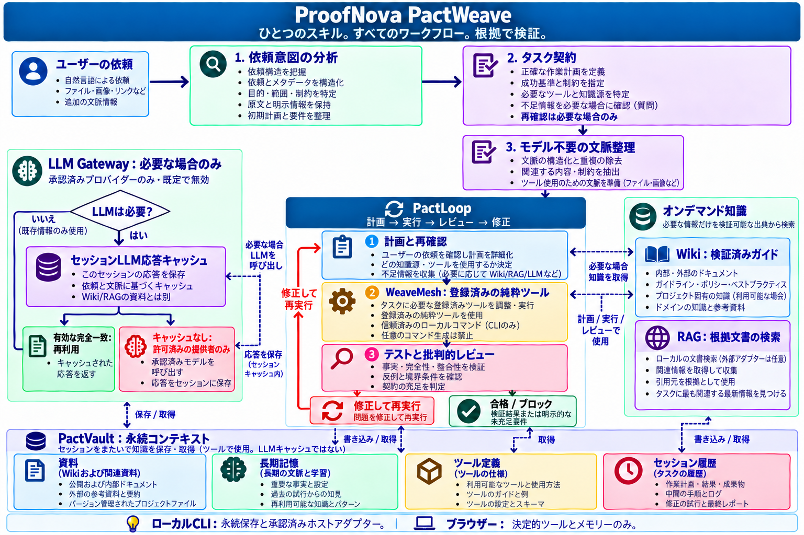

<a href="README.md"><kbd>English</kbd></a> · <a href="README.ko.md"><kbd>한국어</kbd></a> · <a href="README.ja.md"><kbd>日本語 ✓</kbd></a> · <a href="README.zh-CN.md"><kbd>简体中文</kbd></a>

# ProofNova PactWeave

**One Skill. Every Workflow. Verified.**

依頼を理解し、実行契約を確定し、登録済みツールを実行して根拠で検証する、ひとつのインストール可能なスキルです。モデルは任意です。未対応の依頼を完了扱いにはしません。

アーキテクチャと製品方針は ProofNova の設計です。PactLoop、WeaveMesh、PactVault は独立実装の内部モジュールであり、唯一の公開スキルは `pactweave` です。



画像の言語： [English](assets/architecture/pactweave-architecture-en.png) · [한국어](assets/architecture/pactweave-architecture-ko.png) · [日本語](assets/architecture/pactweave-architecture-ja.png) · [简体中文](assets/architecture/pactweave-architecture-zh-CN.png)

## クイックスタート

Node.js 22 以降が必要です。必須の実行時パッケージ、アカウント、API キー、有料プロバイダー、自動ダウンロードはありません。リポジトリの取得は利用者の明示的操作です。下記はローカルの合成データを使い、実際の送金や外部サービスへの接続は行いません。

```sh
git clone https://github.com/proofnova/proofnova-pactweave.git
cd proofnova-pactweave
node cli.mjs doctor --json
node cli.mjs analyze examples/invoice.json --json
node cli.mjs run examples/invoice.json --json
node --test
```

例は USD 10.00 の請求書と USD 12.00 の入金です。契約は `result.summary.paid` が `1` であることを要求します。出力でその条件、未配賦額の保持、依頼原文、実行・レビューの根拠を確認してください。タスクや基準がなければ `BLOCKED` です。未達の基準を完了と報告してはいけません。

## 公開スキルひとつをインストール

[SKILL.md](SKILL.md) と相対パスのソースを保ったまま、利用するエージェントのスキル配置場所にコピーし、ホストの Agent Skills 互換ローダーを使ってください。CLI にエージェントホストは不要です。任意の `npm link` で、このチェックアウトの `pactweave` コマンドを登録できます。レジストリからのパッケージ取得ではありません。

インストール先のスキルフォルダー名は **`pactweave`** とし、その直下に `pactweave/SKILL.md` と相対パスのソースを配置してください。GitHub のリポジトリ名 `proofnova-pactweave` は変えず、ホストのスキルディレクトリへ配置するときにフォルダー名を変更します。SKILL.md までの間に余分な `proofnova-pactweave` 階層を作らないでください。

## 実際のブラウザエンジン

[デモを開く](https://proofnova.github.io/workspaces/pactweave/)。照合、入力不足、基準未達の例を選び、依頼、契約、計画、キャッシュ、任意の知識検索、モデル呼び出し、PactLoop イベント、根拠、最終 JSON を確認できます。入力変更で古い根拠とダウンロードを無効にします。入力はページのメモリだけに保持し、言語選択だけを保存します。静的ファイルは通常取得しますが、入力データは送信しません。

## 機能ごとの対応範囲

| 機能                                             | ブラウザ                 | ローカル CLI                 |
| ------------------------------------------------ | ------------------------ | ---------------------------- |
| 規則による意図分析・型付き契約質問               | 対応                     | 対応                         |
| 登録済み ProofNova 純粋ツール                    | 対応                     | 対応                         |
| PactLoop・WeaveMesh の決定的ジョブ実行           | 対応                     | 対応                         |
| 出典付き Wiki/RAG 分割・BM25 検索                | メモリ内文書             | 永続ローカル文書             |
| セッション応答キャッシュ                         | メモリのみ、モデル未設定 | TTL・無効化対応の別領域      |
| PactVault 永続化・復元・保持期間・エクスポート   | ローカル CLI が必要      | 対応                         |
| 信頼したプロジェクトコマンド                     | ローカル CLI が必要      | 明示的ホスト権限が必要       |
| モデルプロバイダーのコールバック                 | デモには未設定           | Gateway 経由で任意設定       |
| 有料呼び出し・無制限通信・自動コード取得         | 無効                     | 既定で無効                   |
| 任意の自然文からのシェル実行・未対応の意味タスク | 非対応                   | 明示的能力がなければ BLOCKED |

## 固定したアーキテクチャ

依頼原文 → 意図分析 → タスク契約 → モデル不要の文脈前処理 → PactLoop の計画・実行・レビュー・修復 → 根拠と最終報告。Wiki、RAG、LLM Gateway は計画・実行・レビュー中の情報不足に応じて使う分岐です。全依頼に強制する初期段階ではありません。

**PactLoop** は上限付き反復、否定的レビュー、修復、再開にわたり原文と受け入れ契約を維持します。重要な失敗は平均点で相殺しません。

**WeaveMesh** は登録ハンドラーと依存ジョブを実行します。役割は実際に動いた関数を示し、架空の AI 従業員を演出しません。有用な独立作業だけを並列化し、共有書き込みは直列化します。

**PactVault** は Resources、Memory、Skills、Sessions を範囲付き ID、ハッシュ、復元機能とともにローカル保存します。セッション LLM 応答は長期知識とは物理的に分離します。

**LLM Gateway** が唯一の呼び出し境界です。有効な完全一致キャッシュだけが呼び出しを省けます。類似応答は信頼しない補助文脈であり、正解とはみなしません。出典・契約・権限の変更で無効化します。

## 測定可能なタスク契約

既定の例は `invoice-reconciliation`、構造化入力、重要な判定基準を明示します。エンジン自身の実行・ダイジェスト・スキーマ・出力の不変条件も適用します。空の基準で検査を回避できません。修復は契約内の入力や計画に限り、目標や権限を書き換えません。

## CLI コマンド

`analyze`、`plan`、`run`、`resume`、`status`、`verify`、`explain`、`cache`、`wiki`、`rag`、`memory`、`doctor`、`stats`、`export` をひとつの入口から提供します。引数は `node cli.mjs --help` を参照してください。JSON 出力に対応します。終了コードは成功 0、実行・検証失敗 1、前提不足 2、承認必要 3、予算終了・取消 4 です。

引数、タスク ID、再開、任意のホスト設定は [CLI ガイド](docs/cli.md) を参照してください。

## 実測結果と再現

Windows / Node.js 24.13.1 で **自動テスト142/142件が通過**し、実際のブラウザ UI から **30アダプターの通常・境界例60/60件**を実行しました。英語・韓国語・日本語・簡体字中国語の請求書例はすべて PASS。タスク不足と基準未達は BLOCKED、不正 JSON は ERROR となりダウンロードを無効化しました。390 × 844 のモバイル表示では横方向のはみ出しやフォームラベル欠落はありませんでした。**CLI 14コマンド**を実行して JSON を確認し、新たに展開した配布アーカイブでも請求書例と全142テストが通過しました。

[生ベンチマーク](benchmarks/results/raw.json) は **16/16件の期待動作**を記録しています。内訳は14件の PASS と意図した2件の BLOCKED です。6分野の既存開発例で登録実行器は **6/6件完了**し、CPU 上の **SmolLM2-135M-Instruct q4** は新規64トークン制限で厳密なフラット JSON 検査に **0/6件通過**しました。開発済み例であり未知問題ではなく、一般推論能力の測定でもありません。多くの応答は説明文または切り詰められた出力です。ツールと構造化入力は明示的に指定しています。

実際のキャッシュ実験は、**キャッシュなし3呼び出し、あり2呼び出し**で、完全一致1件と呼び出し回避1件でした。出典版の変更で新たな推論が必要になりました。この形式課題では全応答が正解検査に失敗し、**キャッシュは回答品質を改善しませんでした**。最終実験は実推論11回を完了しました。失敗した過去2回も保存し、最初の EXECUTED 表示は12件すべてが推論前に失敗したため有効な比較ではないと明記しています。トークン削減は未測定です。

[検証記録](docs/verification.md)、[実験方法と失敗履歴](benchmarks/README.md)、[CLI ガイド](docs/cli.md)、[テストログ](docs/evidence/test-run-02.txt)、[ブラウザ根拠](docs/evidence/browser-adapters.json) を参照してください。`node --test` と記録された設定で再現できます。ローカル合成測定だけで普遍的な精度や外部利用効果を証明するものではありません。

## 制限と非対応

登録済み能力を接続する有界エンジンです。規則による分析は全依頼の人間並み理解を保証しません。ランタイム検出はあらゆる言語や運用基盤の完全自動化ではありません。信頼したコマンドは利用者権限でローカルコードを実行し、OS サンドボックスではありません。保存データは本製品では暗号化しません。ブラウザ実行だけでディスク復元や提供者連携を実証できず、合成テストだけで外部利用効果は証明できません。

## 権限とデータ

タスク JSON、通常回答、検索文書、キャッシュは権限を付与できません。ホスト権限と契約の共通範囲だけが有効で、禁止が優先します。リモート push、破壊的変更、認証情報アクセス、外部転送、有料サービス、本番変更には明示権限が必要です。`.pactweave/`、生セッション、バックアップ、資格情報を Git に登録しないでください。エクスポートのマスキングに加え、共有前にファイルを確認してください。

## 関連文書

[アーキテクチャ](docs/architecture.ja.md) · [設計](DESIGN.md) · [研究と反証](RESEARCH.md) · [ライセンス監査](LICENSE_AUDIT.md) · [告知](THIRD_PARTY_NOTICES.md) · [セキュリティ](SECURITY.md) · [貢献](CONTRIBUTING.md) · [変更履歴](CHANGELOG.md)

動くツール、明確な文書、保守可能なインターフェース、正直な根拠による有用なオープンソース貢献を目指します。斬新さとデモだけでは影響を証明できません。
