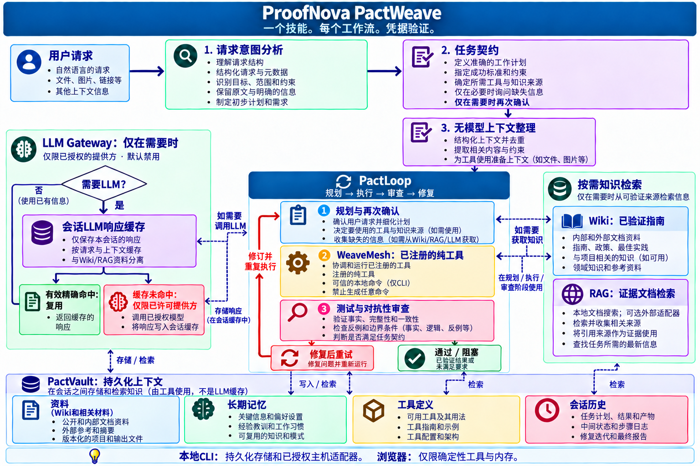

<a href="README.md"><kbd>English</kbd></a> · <a href="README.ko.md"><kbd>한국어</kbd></a> · <a href="README.ja.md"><kbd>日本語</kbd></a> · <a href="README.zh-CN.md"><kbd>简体中文 ✓</kbd></a>

# ProofNova PactWeave

**One Skill. Every Workflow. Verified.**

一个可安装技能：理解请求、绑定执行契约、运行已注册工具，并依据证据核验结果。模型为可选项，未知任务会被明确阻止，不伪装成完成。

架构与产品方向由 ProofNova 设计。PactLoop、WeaveMesh、PactVault 是该架构的独立内部实现，唯一公开技能为 `pactweave`。



图片语言： [English](assets/architecture/pactweave-architecture-en.png) · [한국어](assets/architecture/pactweave-architecture-ko.png) · [日本語](assets/architecture/pactweave-architecture-ja.png) · [简体中文](assets/architecture/pactweave-architecture-zh-CN.png)

## 快速开始

需要 Node.js 22 或更高版本。无强制运行时依赖、账号、API 密钥、付费提供方或自动下载。克隆仓库是用户明确执行的操作。以下命令使用本地合成数据，不会实际付款或联系外部服务。

```sh
git clone https://github.com/proofnova/proofnova-pactweave.git
cd proofnova-pactweave
node cli.mjs doctor --json
node cli.mjs analyze examples/invoice.json --json
node cli.mjs run examples/invoice.json --json
node --test
```

示例包含 USD 10.00 发票与 USD 12.00 付款，契约要求 `result.summary.paid` 等于 `1`。请检查实际输出中的条件、未分配金额、原始请求和执行审查证据。缺少任务或验收条件将返回 `BLOCKED`；未满足条件绝不能被报告为完成。

## 安装唯一公开技能

保留 [SKILL.md](SKILL.md) 与相对路径源码，将仓库复制到代理支持的技能目录，使用宿主的 Agent Skills 兼容加载器。CLI 不依赖代理宿主。可选执行 `npm link`，将当前检出的 `pactweave` 注册为命令，这不是从包注册表下载产品。

安装的技能文件夹必须命名为 **`pactweave`**，根目录直接包含 `pactweave/SKILL.md`，并保留全部相对路径源码。GitHub 仓库名称仍为 `proofnova-pactweave`，仅在放入宿主技能目录时调整本地文件夹名。不要在技能目录与 SKILL.md 之间再嵌套一层 `proofnova-pactweave`。

## 真实浏览器引擎

[打开演示](https://proofnova.github.io/workspaces/pactweave/)。选择发票核对、任务缺失或条件失败示例，检查请求、契约、计划、缓存、可选知识查询、模型调用、PactLoop 事件、证据及最终 JSON。更改输入会使旧证据与下载失效。输入仅存于页面内存，只保存语言选择。静态文件正常加载，任务输入不会上传。

## 各功能支持范围

| 功能                                       | 浏览器             | 本地 CLI                 |
| ------------------------------------------ | ------------------ | ------------------------ |
| 规则意图分析与有类型的契约问题             | 支持               | 支持                     |
| 已注册 ProofNova 纯工具执行                | 支持               | 支持                     |
| PactLoop 与 WeaveMesh 确定性角色及任务执行 | 支持               | 支持                     |
| 带来源的本地 Wiki/RAG 分块与 BM25          | 内存文档           | 持久本地文档             |
| 会话响应缓存管理                           | 仅内存，未配置模型 | 独立本地缓存、TTL 和失效 |
| PactVault 持久化、恢复、保留期限、导出     | 需要本地 CLI       | 支持                     |
| 受信任项目命令                             | 需要本地 CLI       | 需要明确宿主权限         |
| 模型提供方回调                             | 本演示未配置       | 通过 Gateway 可选配置    |
| 付费调用、不受限网络、自动代码下载         | 禁用               | 默认禁用                 |
| 任意自然语言转 shell、未支持的语义任务     | 不支持             | 无明确可信能力时 BLOCKED |

## 固定架构

原始请求 → 意图分析 → 任务契约 → 无模型上下文预处理 → PactLoop 规划、执行、审查、修复 → 证据与最终报告。Wiki、RAG 和 LLM Gateway 仅在规划、执行、审查中出现明确知识缺口时按需使用，不是每项任务的强制启动阶段。

**PactLoop** 在有界重试、负面审查、修复和恢复期间保持原始请求与验收契约。关键失败不会被平均分抵消。

**WeaveMesh** 执行已注册处理器和依赖任务。角色表示实际运行的函数，而非虚构 AI 员工。仅并行执行有用的独立工作，共享写入串行进行。

**PactVault** 使用限定范围的标识符、哈希和恢复机制，在本地保存 Resources、Memory、Skills、Sessions。会话 LLM 响应缓存与长期知识物理分离。

**LLM Gateway** 是唯一模型调用边界。只有有效的精确缓存命中可省略调用。相似响应仅是不可信补充上下文，不能自动当成正确答案。来源、契约或权限变化会使复用失效。

## 可衡量的任务契约

默认演示明确指定 `invoice-reconciliation`、结构化输入及关键验收条件。引擎还强制执行运行、摘要、模式和输出不变量，不能通过空条件绕过。修复只能在同一契约内修改输入或计划，不能改写目标或授予权限。

## CLI 命令

统一入口提供 `analyze`、`plan`、`run`、`resume`、`status`、`verify`、`explain`、`cache`、`wiki`、`rag`、`memory`、`doctor`、`stats`、`export`。具体参数请运行 `node cli.mjs --help`。支持 JSON 输出。退出码分别为成功 0、执行或验证失败 1、前提信息不足 2、需要批准 3、预算耗尽或取消 4。

完整参数、任务 ID、恢复及可选宿主设置请参阅 [CLI 指南](docs/cli.md)。

## 实测结果与复现

在 Windows / Node.js 24.13.1 上，**自动测试142/142项通过**，并通过真实浏览器 UI 执行了 **30个适配器的正常与边界样例60/60项**。英文、韩文、日文和简体中文发票样例均为 PASS。任务缺失、条件未满足分别正确返回 BLOCKED；错误 JSON 返回 ERROR 并禁用下载。390 × 844 移动视图未发现横向溢出或缺少表单标签。实际执行并解析了 **14个 CLI 命令**的 JSON，新解压的发行包也通过发票工作流和全部142项测试。

[基准原始记录](benchmarks/results/raw.json)包含 **16/16项预期行为**：14项 PASS、2项预期 BLOCKED。六个领域的既有开发样例中，注册执行器 **6/6项完成**；CPU 上的 **SmolLM2-135M-Instruct q4** 在64个新 token 限制下，严格扁平 JSON 检查为 **0/6项通过**。这些是开发中已使用的样例，不是未知测试集，也不是通用推理能力测试。许多模型响应是说明文字或被截断。执行工具和结构化输入均由任务明确指定。

真实缓存实验为 **无缓存3次调用、有缓存2次调用**，精确命中1次、避免调用1次。来源版本变化迫使新推理。该缓存格式任务的全部响应都未通过答案检查，因此 **缓存并未改善答案质量**。最终实验完成11次真实推理。先前两次失败保留在历史中；首次记录虽标记 EXECUTED，但12次提供方尝试均在推理前失败，不能作为有效模型比较。未测量 token 节约。

详见[验证记录](docs/verification.md)、[实验方法与失败历史](benchmarks/README.md)、[CLI 指南](docs/cli.md)、[测试日志](docs/evidence/test-run-02.txt)、[浏览器证据](docs/evidence/browser-adapters.json)。运行 `node --test` 并使用记录的配置即可复现。本地合成测量不能证明普遍准确率或外部用户收益。

## 限制与未支持范围

这是连接已注册能力的有界工作流引擎。规则分析不保证人类水平地理解所有请求，检测到运行时也不代表完全自动化所有语言与运维平台。受信任命令以用户权限执行本地代码，不是操作系统沙箱。本项目不加密本地记录。浏览器运行不能证明磁盘恢复或模型联动，合成测试也不能证明外部用户效果。

## 权限与数据

任务 JSON、普通回答、检索文档及缓存响应不能授予权限。有效权限是宿主授权与契约许可的交集，禁止项优先。远程 push、破坏性修改、凭据访问、外部传输、付费服务及生产修改都需明确限定范围的授权。不要提交 `.pactweave/`、原始会话、备份和凭据。脱敏导出仍需在分享前人工检查。

## 项目文档

[架构](docs/architecture.zh-CN.md) · [设计](DESIGN.md) · [研究与反证](RESEARCH.md) · [许可证审查](LICENSE_AUDIT.md) · [声明](THIRD_PARTY_NOTICES.md) · [安全](SECURITY.md) · [贡献](CONTRIBUTING.md) · [变更](CHANGELOG.md)

目标是通过可运行工具、清晰文档、可维护接口和真实证据提供有用的开源贡献。创意与演示本身不能证明实际影响。
