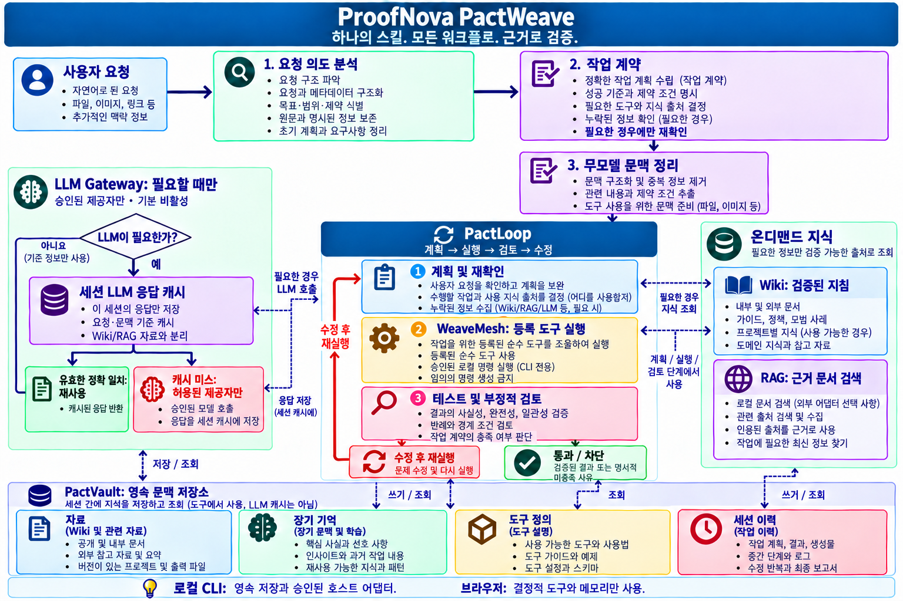

<a href="../README.md"><kbd>English</kbd></a> · <a href="../README.ko.md"><kbd>한국어 ✓</kbd></a> · <a href="../README.ja.md"><kbd>日本語</kbd></a> · <a href="../README.zh-CN.md"><kbd>简体中文</kbd></a>

# ProofNova PactWeave — 고정된 아키텍처

아키텍처와 제품 방향은 ProofNova가 설계했습니다. PactLoop·WeaveMesh·PactVault는 해당 설계를 독립적으로 구현하는 내부 모듈이며, 공개 스킬은 `pactweave` 하나입니다.

이미지 언어: [English](../assets/architecture/pactweave-architecture-en.png) · [한국어](../assets/architecture/pactweave-architecture-ko.png) · [日本語](../assets/architecture/pactweave-architecture-ja.png) · [简体中文](../assets/architecture/pactweave-architecture-zh-CN.png)

원본 요청 → 의도 분석 → 작업 계약 → 무모델 문맥 전처리 → PactLoop 계획·실행·검토·수정 → 근거와 최종 보고 순서를 유지합니다. Wiki·RAG·LLM Gateway는 계획·실행·검토 중 명시적인 정보 공백이 있을 때만 사용하는 분기이며, 모든 작업의 필수 시작 단계가 아닙니다.

**PactLoop**는 제한된 반복·부정적 검토·수정·재개 과정에서 원본 요청과 수용 계약을 유지합니다. 중요한 실패를 평균 점수로 상쇄하지 않습니다.

**WeaveMesh**는 등록된 처리기와 의존 작업을 실행합니다. 역할은 실제 실행한 함수를 나타내며 가상의 AI 직원을 뜻하지 않습니다. 독립적이고 유용한 작업만 병렬화하고 공유 쓰기는 직렬화합니다.

**PactVault**는 Resources·Memory·Skills·Sessions를 범위별 식별자·해시·복구와 함께 로컬에 저장합니다. 세션 LLM 응답은 물리적으로 분리된 캐시이며 장기 지식과 다릅니다.

**LLM Gateway**만 제공자를 호출합니다. 유효한 정확 캐시만 호출을 생략할 수 있습니다. 유사한 응답은 신뢰하지 않는 보조 문맥이며 정답이 아닙니다. 출처·계약·권한이 바뀌면 재사용을 무효화합니다.

## 기능별 지원 범위

| 기능                                         | 브라우저                 | 로컬 CLI                             |
| -------------------------------------------- | ------------------------ | ------------------------------------ |
| 규칙 기반 의도 분석·유형이 있는 계약 질문    | 지원                     | 지원                                 |
| 등록된 ProofNova 순수 도구 실행              | 지원                     | 지원                                 |
| PactLoop·WeaveMesh 결정적 역할·작업 실행     | 지원                     | 지원                                 |
| 출처를 포함한 로컬 Wiki/RAG 분할·BM25 검색   | 메모리 문서              | 영속 로컬 문서                       |
| 세션 응답 캐시 관리                          | 메모리 전용, 모델 미설정 | TTL·무효화를 지원하는 별도 로컬 캐시 |
| PactVault 저장·복구·보존·내보내기            | 로컬 CLI 필요            | 지원                                 |
| 신뢰한 프로젝트 명령                         | 로컬 CLI 필요            | 명시적 호스트 권한 필요              |
| 모델 제공자 콜백                             | 데모에 설정되지 않음     | Gateway를 통한 선택적 제공자         |
| 유료 호출·무제한 네트워크·자동 코드 다운로드 | 비활성화                 | 기본 비활성화                        |
| 임의 자연어→셸 실행·지원 밖의 의미 작업      | 미지원                   | 명시적 신뢰 기능이 없으면 BLOCKED    |

## 한계와 미지원 범위

등록된 기능을 연결하는 제한된 실행 엔진입니다. 규칙 기반 분석이 모든 요청의 사람 수준 이해를 보장하지 않습니다. 런타임 감지는 모든 언어·운영 플랫폼의 완전 자동화를 의미하지 않습니다. 신뢰한 프로젝트 명령은 사용자 권한으로 로컬 코드를 실행하며 운영체제 샌드박스가 아닙니다. 로컬 저장 기록은 이 프로젝트가 암호화하지 않습니다. 브라우저 실행만으로 디스크 복구나 제공자 연동을 입증하지 않으며 합성 테스트만으로 외부 사용자 효과를 확인할 수 없습니다.
