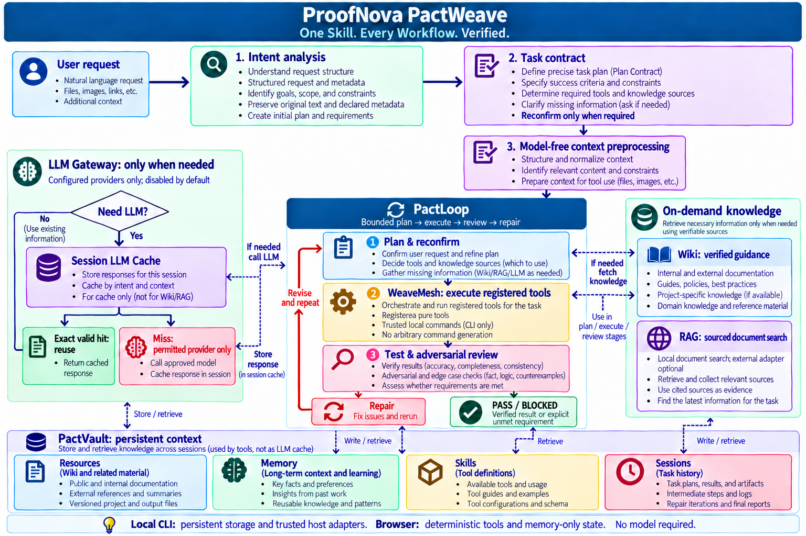

<a href="../README.md"><kbd>English</kbd></a> · <a href="../README.ko.md"><kbd>한국어</kbd></a> · <a href="../README.ja.md"><kbd>日本語</kbd></a> · <a href="../README.zh-CN.md"><kbd>简体中文 ✓</kbd></a>

# ProofNova PactWeave — 固定架构

架构与产品方向由 ProofNova 设计。PactLoop、WeaveMesh、PactVault 是该架构的独立内部实现，唯一公开技能为 `pactweave`。

原始请求 → 意图分析 → 任务契约 → 无模型上下文预处理 → PactLoop 规划、执行、审查、修复 → 证据与最终报告。Wiki、RAG 和 LLM Gateway 仅在规划、执行、审查中出现明确知识缺口时按需使用，不是每项任务的强制启动阶段。

**PactLoop** 在有界重试、负面审查、修复和恢复期间保持原始请求与验收契约。关键失败不会被平均分抵消。

**WeaveMesh** 执行已注册处理器和依赖任务。角色表示实际运行的函数，而非虚构 AI 员工。仅并行执行有用的独立工作，共享写入串行进行。

**PactVault** 使用限定范围的标识符、哈希和恢复机制，在本地保存 Resources、Memory、Skills、Sessions。会话 LLM 响应缓存与长期知识物理分离。

**LLM Gateway** 是唯一模型调用边界。只有有效的精确缓存命中可省略调用。相似响应仅是不可信补充上下文，不能自动当成正确答案。来源、契约或权限变化会使复用失效。

## 各功能支持范围

| 功能 | 浏览器 | 本地 CLI |
| --- | --- | --- |
| 规则意图分析与有类型的契约问题 | 支持 | 支持 |
| 已注册 ProofNova 纯工具执行 | 支持 | 支持 |
| PactLoop 与 WeaveMesh 确定性角色及任务执行 | 支持 | 支持 |
| 带来源的本地 Wiki/RAG 分块与 BM25 | 内存文档 | 持久本地文档 |
| 会话响应缓存管理 | 仅内存，未配置模型 | 独立本地缓存、TTL 和失效 |
| PactVault 持久化、恢复、保留期限、导出 | 需要本地 CLI | 支持 |
| 受信任项目命令 | 需要本地 CLI | 需要明确宿主权限 |
| 模型提供方回调 | 本演示未配置 | 通过 Gateway 可选配置 |
| 付费调用、不受限网络、自动代码下载 | 禁用 | 默认禁用 |
| 任意自然语言转 shell、未支持的语义任务 | 不支持 | 无明确可信能力时 BLOCKED |

## 限制与未支持范围

这是连接已注册能力的有界工作流引擎。规则分析不保证人类水平地理解所有请求，检测到运行时也不代表完全自动化所有语言与运维平台。受信任命令以用户权限执行本地代码，不是操作系统沙箱。本项目不加密本地记录。浏览器运行不能证明磁盘恢复或模型联动，合成测试也不能证明外部用户效果。
